# Design Review (dari Design Review.docx, urutan asli)

Section

Klunting

Budget

Notes:

Home

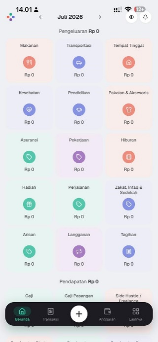

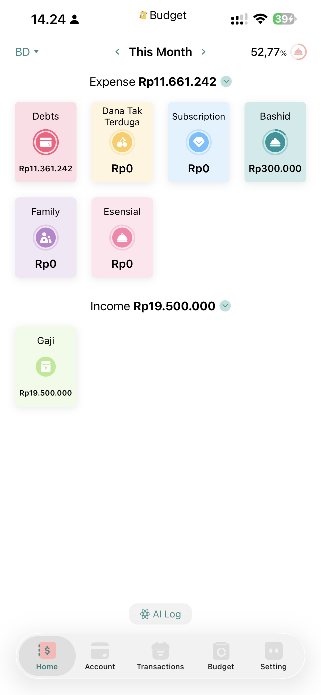

Bagian header kita tidak rapi, bahkan untuk nama bulan tidak center, entah ada icon di kanan kirinya mohon tetap center, dan panah arahnya ga perlu jauh begitu. Kalo mau pakai icon kita itu saranku ngga disitu tapi di atas posisi center, di pojok kiri itu kamu bisa ikutin budget, pojok kirinya budget itu adalah pilihan Ledger.

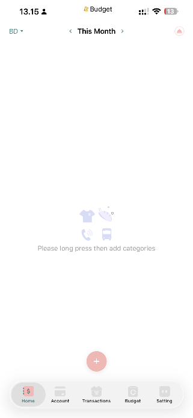

Lalu ketika data kosong tidak ada budget dan realisasi tampilanya mohon ikuti Budget App

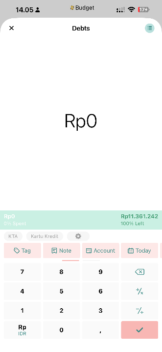

Ini adalah tampilan ketika salah satu card dibuka, kita bisa memilih sub kategori, input realisasi pengeluaran, memberi tak, notes, dan ditampilkan juga sisa budgetnya.

Transactions

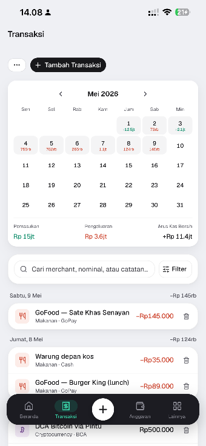

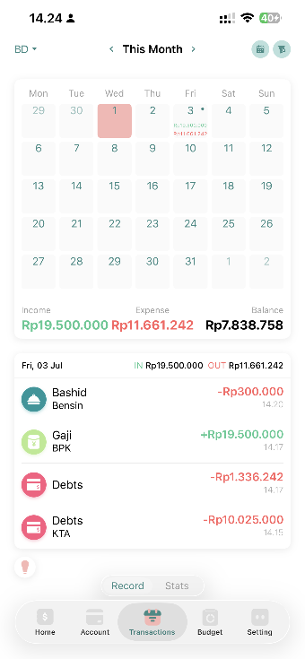

Tampilan transaction sudah hampir mengikuti Buget App sih, cuman nanti mohon sempurnakan saja apa yang bisa di-improve

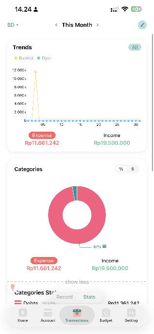

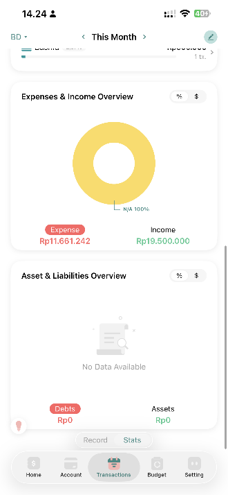

Dalam page transaction selain ada page record yang di atas tadi ada juga stats, peralihan page menggunakan toogle. Nah aku nanti inginya tidak hanay mengikuti Budget App tapi juga pingin ada sankey di sini.

Budget

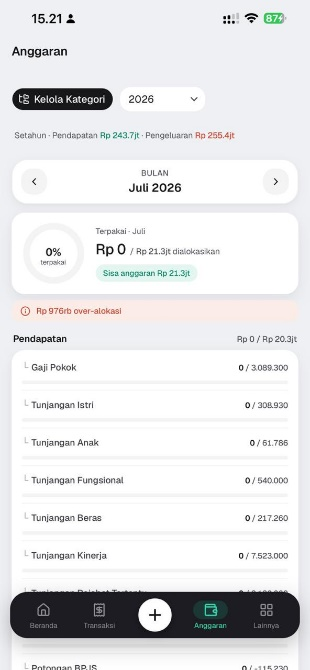

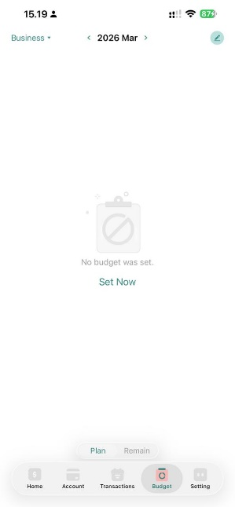

Atur tampilan saat data kosong

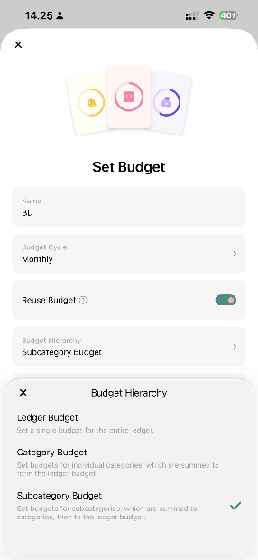

Bisa pilih hirariki budgetnya.

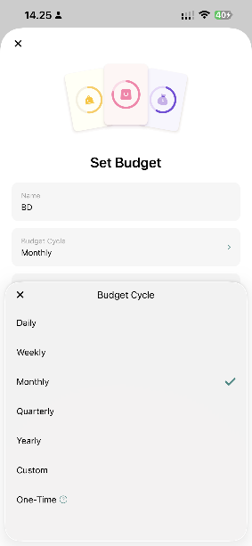

Bisa pilih cycle

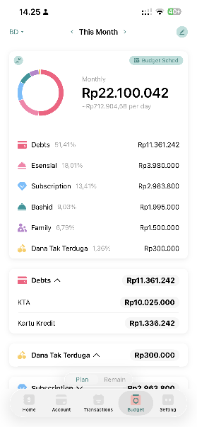

Tampilan akhir di Bugdet App ketika semua sudah terisi

Account

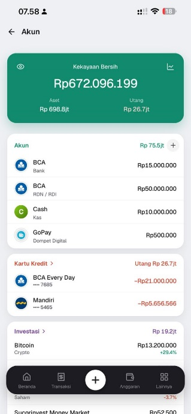

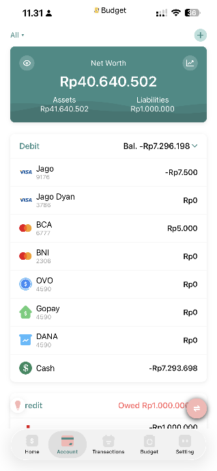

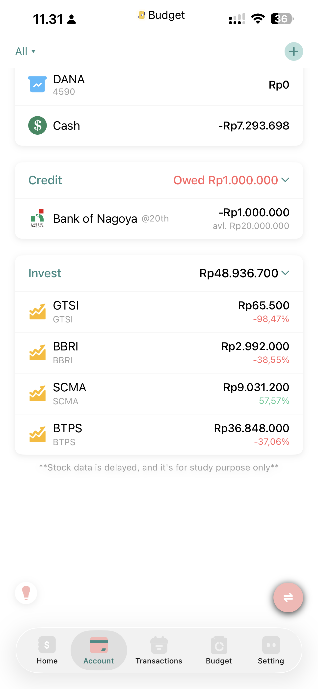

Sejauh ini sudah bagus, namun, pada Budget App menampilkan semua akun termasuk investasi. Khusus investasi di klunting akan ada page sendiri, jadi akun hanya khusus akun pembayaran saja baik cash, debit, kredit.

Sharing Manager

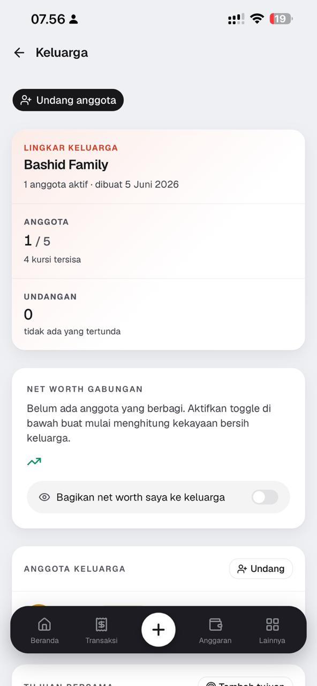

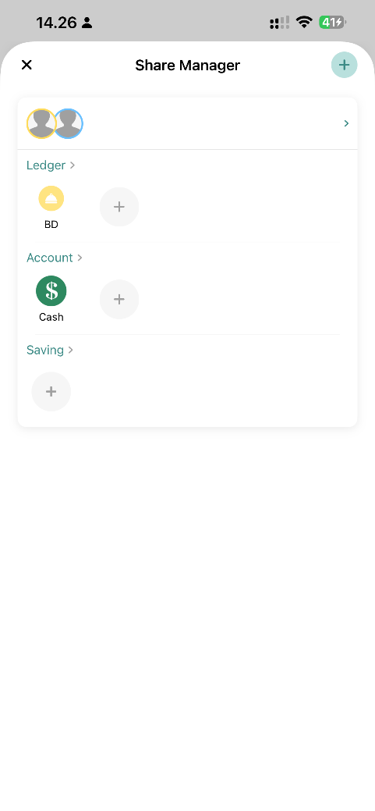

Sebetulnya konsep kita sudah oke, tapi mohon lebih disimplekan agar orang mudah paham ya

Ledger Manager

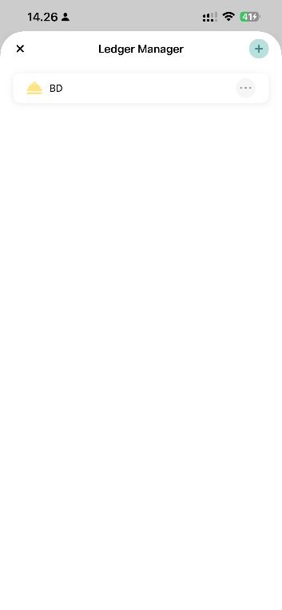

Ada ledger manager

Recurring, Installment, Subscription

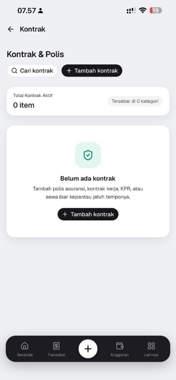

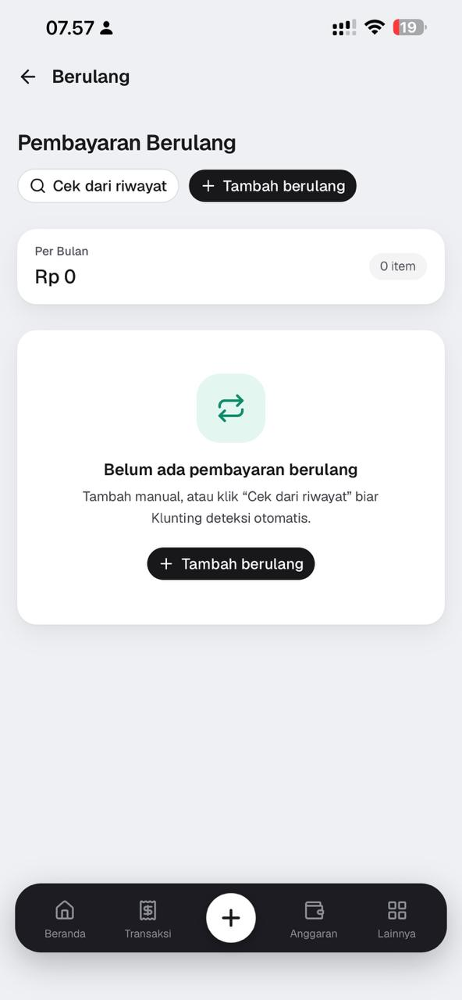

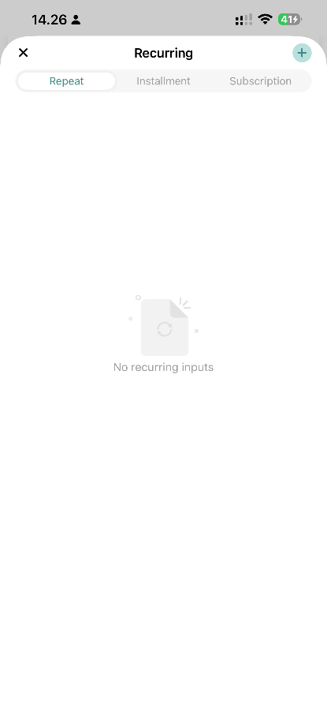

Pada Budget App Recurring, installment, dan subscription digabung, saya rasa lebih simple, dan bisa ditiru dan modifikasi

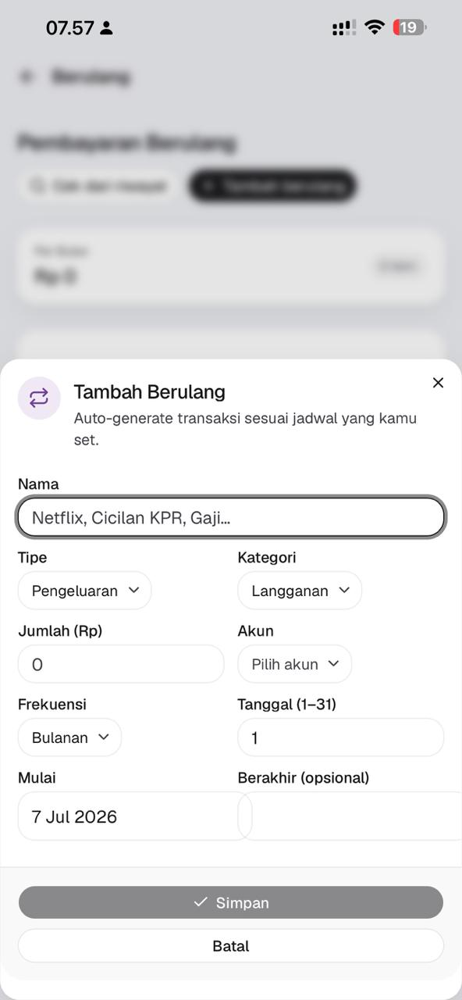

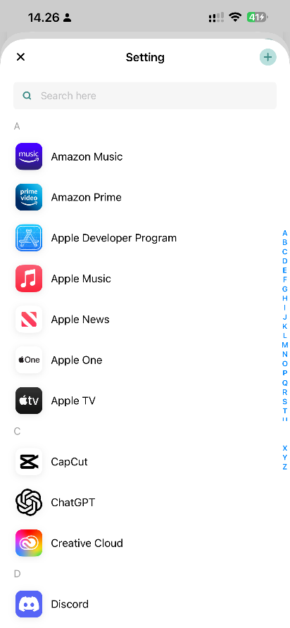

Sediakan banyak provider subscription

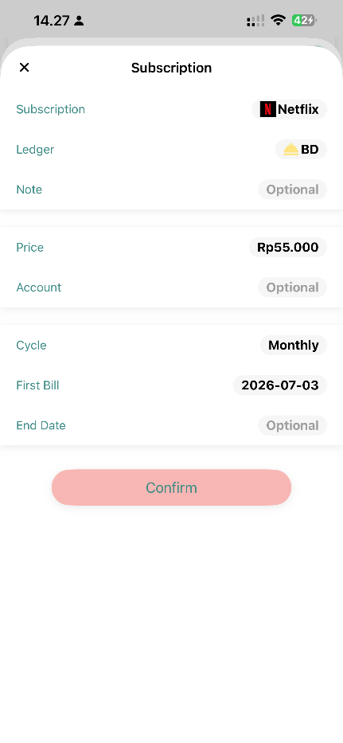

Tiru, amati, modifikasi

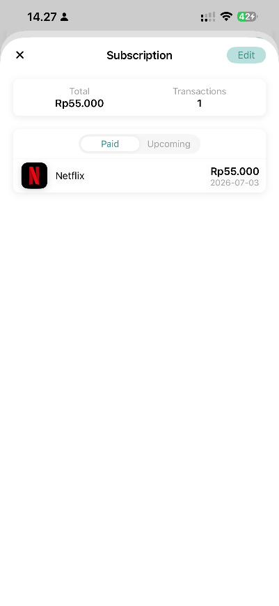

Tiru, amati, modifikasi

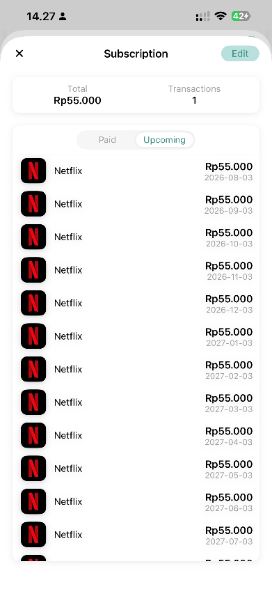

Tiru, amati, modifikasi

Lain-Lain

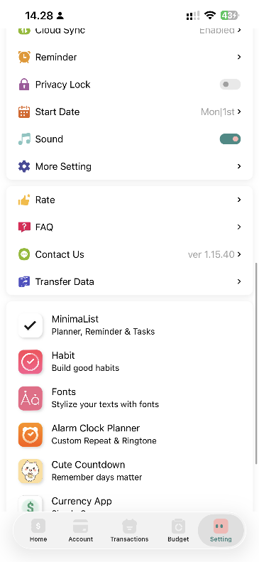

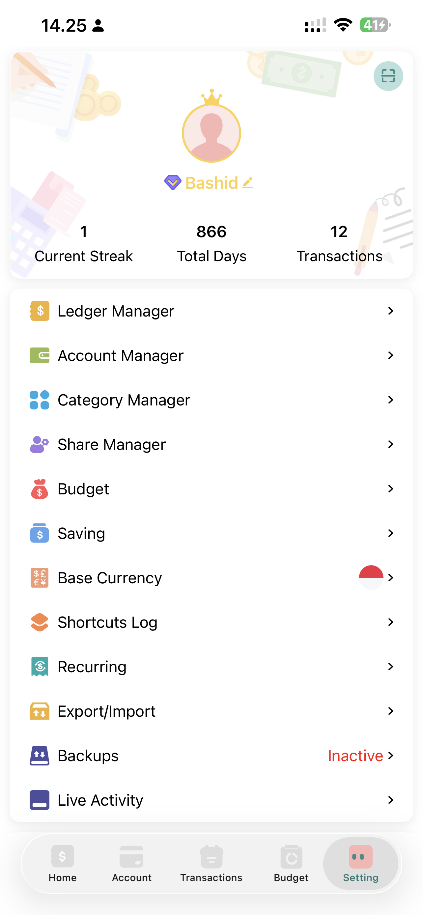

Tiru, amati, modifikasi
